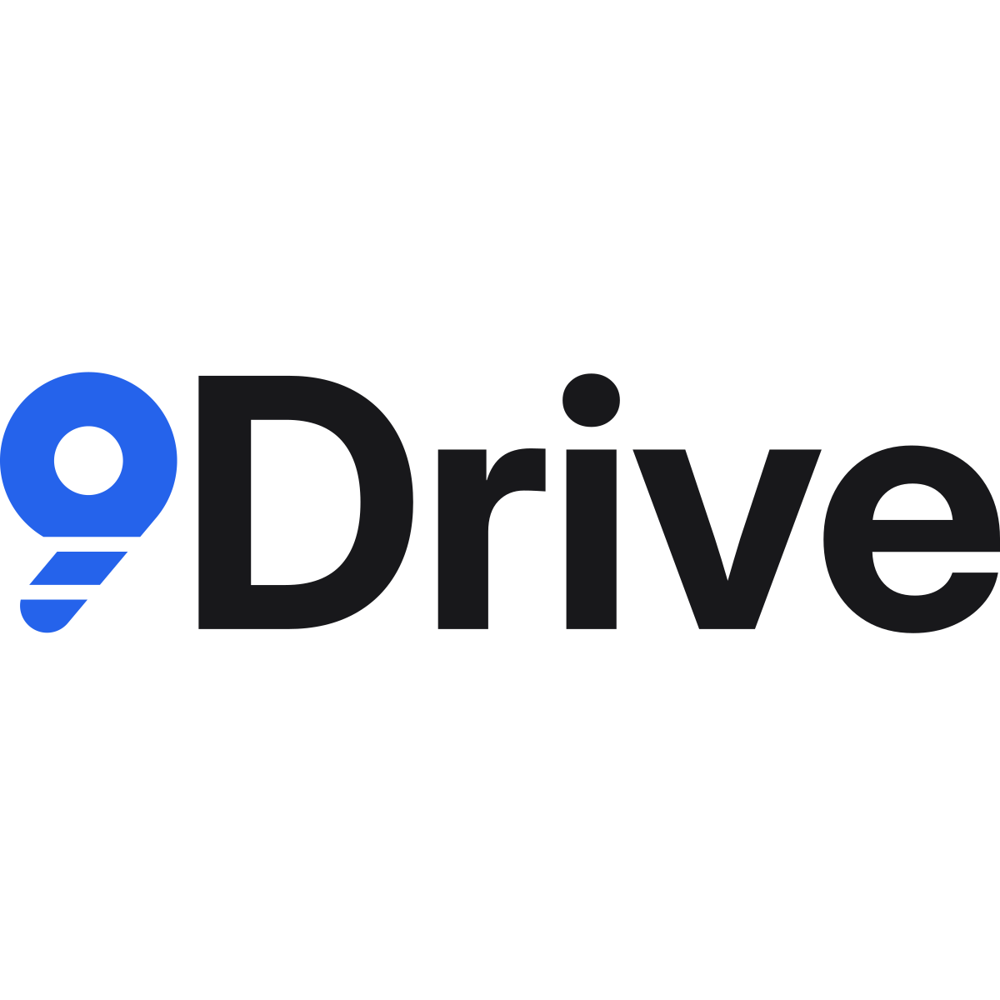

# Logo 9Drive



**Ide:** angka 9 geometris yang diiris menjadi lapisan bertumpuk, seperti beberapa drive yang ditumpuk menjadi satu ruang. Simbol ini sekaligus menjadi angka "9" dalam nama, sehingga lockup terbaca **9**Drive.

## Dua potongan simbol

| Potongan | Kapan dipakai | File |
|---|---|---|
| **Penuh** (mangkuk + dua lapisan ekor) | Tinggi simbol **48 px ke atas**: halaman login, ikon app, cetak, slide | `svg/9drive-mark.svg` |
| **Kecil** (mangkuk + satu lapisan ekor) | Tinggi simbol **40 px ke bawah**: favicon, sidebar, tab browser | `svg/9drive-mark-small.svg` |

Jangan memakai potongan penuh di bawah 40 px karena irisannya akan menutup dan terlihat kotor.

## Lockup

- **Horizontal:** `svg/9drive-lockup.svg` (penuh) dan `svg/9drive-lockup-small.svg` (untuk tinggi ≤ 40 px, misalnya sidebar).
- **Bertumpuk:** `svg/9drive-lockup-stacked.svg`, untuk ruang yang sempit dan tinggi.
- Versi `-dark` dipakai di atas latar gelap. Versi `-black` / `-white` adalah versi satu warna (stempel, emboss, cetak satu warna).
- Jarak antara simbol dan "Drive" serta ukuran relatifnya sudah dikunci. Jangan menyusun ulang dari huruf ketikan.

## Warna

| Peran | Terang | Gelap |
|---|---|---|
| Simbol | `#2563eb` · RGB 37 99 235 | `#6b9bf2` · RGB 107 155 242 |
| "Drive" | `#18181b` · RGB 24 24 27 | `#ededef` · RGB 237 237 239 |

Nilainya sama dengan token UI (`--accent`, `--text`). Di kode, pakai komponen `LogoMark` / `LogoLockup` (`frontend/src/components/brand/Logo.tsx`); warnanya mengikuti tema otomatis lewat `text-accent` dan `text-text`. Kode Pantone/CMYK belum ditetapkan; kalau perlu cetak, cocokkan dengan proof dari percetakan.

## Huruf

"Drive" memakai **Inter Display Bold** (lisensi SIL OFL, boleh untuk logo), sudah dikonversi menjadi path. Ketebalan batangnya (0,207 × tinggi kapital) sama dengan tebal goresan angka 9. Teks UI tetap memakai Inter biasa.

## Ruang kosong dan ukuran minimum

- **Ruang kosong** di sekeliling logo minimal setara diameter lubang tengah angka 9 (± ¼ tinggi simbol). Jangan ada teks atau tepi elemen lain di dalam area itu.
- **Minimum:** simbol kecil 16 px, simbol penuh 48 px, lockup horizontal 20 px tinggi.

## Latar yang boleh

- Putih / `--bg` / `--surface` dengan versi terang.
- Latar gelap UI dengan versi `-dark`.
- Biru `#2563eb` hanya dengan simbol putih (seperti ikon app, `svg/9drive-mark-app-icon.svg`).
- Foto atau latar ramai hanya dengan versi putih/hitam satu warna di area yang tenang.

## Jangan

- Menambah gradien, bayangan, outline, atau efek kaca.
- Mengubah warna simbol selain biru, hitam, atau putih.
- Memutar, memiringkan, merenggangkan, atau mengubah proporsi.
- Menambah atau menghapus irisan, atau mengisi celah irisannya.
- Menulis "9Drive" lengkap di sebelah simbol (akan terbaca "9 9Drive"); pakai lockup.
- Memakai potongan penuh di bawah 40 px.

## Ikon web

Ada di `frontend/public`: `favicon.svg` (potongan kecil, otomatis lebih terang di tab bertema gelap), `favicon.ico`, `apple-touch-icon.png`, `pwa-192x192.png`, `pwa-512x512.png`, `maskable-512x512.png` (simbol di dalam zona aman Android).

## Membangun ulang

Geometri dihitung persis (busur dan garis, tanpa clip/mask) di `source/geometry.py`. Untuk membuat ulang SVG lockup:

```bash
pip install fonttools uharfbuzz
python design/logo/source/build.py /path/to/InterDisplay-Bold.ttf out/
```

`InterDisplay-Bold.ttf` ada di rilis Inter 4.1 (`extras/ttf/`).
